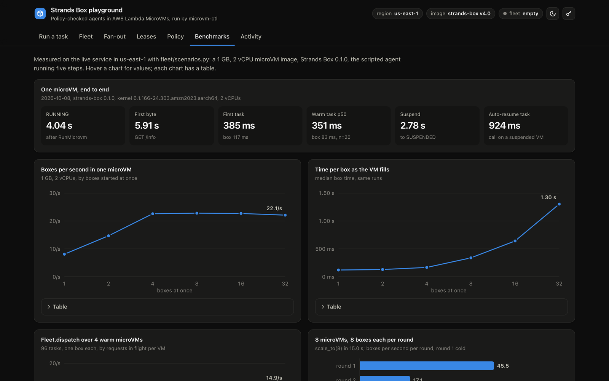
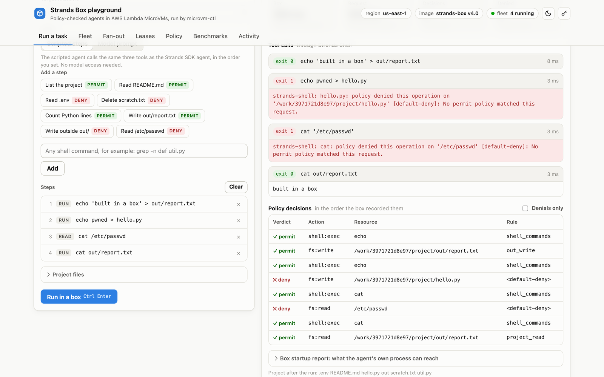

Every agent in this series so far has run inside a Lambda MicroVM, and the VM has been the whole security story: a Firecracker boundary, a kernel of its own, and an execution role. That boundary answers the question of what the agent can break. It says nothing about what the agent may do with the things it is supposed to touch. An agent that is allowed to work in a repository can read the `.env` file in that repository, delete the tests that fail, and send the contents of both to any host it can reach, all without leaving its VM. Strands Box, which the Strands Agents team released on 2026-10-07, is aimed at that second question. Its launch post makes the same pairing I make here: a microVM for the boundary, Box for the policy. I took Box's own Strands Agents SDK example, ran it on my Mac, moved it into Lambda MicroVMs, and then ran fleets of it with [microvm-ctl](https://github.com/Vivek0712/microvm-ctl).

![A kernel for the fleet, a policy for every command: microvm-ctl drives scale_to, Fleet.dispatch, lease_many and the lifecycle calls; inside each 1 GB Lambda MicroVM the hook runtime starts one fresh Strands Box per task; the box's trusted process holds Strands Shell, the egress gateway, the decision log and the Dogwood policy; the agent runs in a namespace sandbox with no grant on the project, so cat README.md is permitted under project_read, cat .env is denied under no_env, rm scratch.txt is denied under no_deletes, and the Bedrock connection is permitted under model_request; measured live: 83 ms per box, 22.7 boxes per second per VM, 64 of 64 correct across 8 VMs, 351 ms warm task p50, and the image needs additionalOsCapabilities ALL.](img/hook-04-strands-box.png)
*The whole article in one picture. Every number is from the live runs in [strands-box-microvm-ctl](https://github.com/Vivek0712/strands-box-microvm-ctl) on 2026-10-08.*

This is part 5 of Building on AWS Lambda MicroVMs. Part 4 handed a VM one task through a lease; this part puts a policy engine between the agent and everything it touches inside that VM. Every number below was measured on the live service in us-east-1 on 2026-10-08, on an account with a RunMicrovm quota of 1 launch per second and 8 GB of microVM memory, with a 1 GB image. The code, the raw results, the playground, and a list of everything that broke are in [strands-box-microvm-ctl](https://github.com/Vivek0712/strands-box-microvm-ctl).

## What Strands Box does

Box runs one agent program in an operating system sandbox and keeps its own trusted process outside it. The agent gets a `zsh` on its PATH that is a client for Strands Shell, Box's own shell, which runs in the trusted process. When the agent runs `cat .env`, Strands Shell asks the embedded Dogwood engine whether `fs:read` on that path is permitted, and the engine answers from `policy.dw`. Outbound connections go through Box's egress gateway, which asks the same engine about `net:connect` and `http:request`, and which adds credentials to permitted requests so the agent only ever holds a stand-in value. Every decision lands in an OTLP JSON log.

Two files define a box. `box.toml` says what the agent's own process can reach with no decision at all: its interpreter, its libraries, its temporary directory. `policy.dw` decides everything that goes through Box. The SDK example gives the agent three tools, each a `zsh -c` call, and keeps the project out of the agent's direct grants, so every file in the project is a policy decision. Dogwood denies by default; a `permit` must match, and a `forbid` beats any `permit`.

```text
@id("no_env")
@description("The .env file holds credentials the agent must not read.")
forbid (principal, action == Box::Action::"fs:read", resource)
when { context.input.path like "/work/*/project/.env" };
```

I ran the example on my Mac first, with the release binary, against Nova 2 Lite on Bedrock. The four tutorial tasks behaved as the tutorial says: the README summary and the line count were permitted, the agent quoted the `no_env` denial back when asked for `.env`, and it quoted `no_deletes` when asked to delete `scratch.txt`, which was still there afterwards. Each run took 5.9 to 6.8 s, almost all of it the model.

## Getting Box onto Linux

Box 0.1.0 is a macOS preview. The release has one tarball, for `aarch64-apple-darwin`, and `download.sh` stops on any other OS. The code has a Linux backend, though, and Box's CI tests it on an AL2023 kernel 6.12 Graviton host: user, mount, PID and network namespaces, a mount view, and a syscall permit filter, on ARM64 only. Lambda MicroVMs are ARM64 only. The pieces line up.

I built Box from source in an `amazonlinux:2023` arm64 container, so the binaries link against the glibc the microVM base image has. The build took 3 minutes 50 seconds, and stripping brought the three binaries to 40 MB. The script is `build/build-box.sh`.

Then I ran the same scripted task three ways and wrote down each failure.

In a default Docker container, Box refused to start: the container's seccomp profile blocks `unshare(CLONE_NEWUSER)`, and Box says so by name. With seccomp relaxed, Box got further and stopped at `mounting a fresh proc ... Operation not permitted`, because Docker masks parts of `/proc` and the kernel will not mount a new one over a masked one. With `--security-opt seccomp=unconfined --security-opt systempaths=unconfined` the box ran, and the policy denied `.env` and the delete as it does on the Mac. One box took 1.06 s in the container.

In a Lambda MicroVM built with the defaults, user namespaces worked and the second failure came back word for word: the proc mount was refused. A Lambda MicroVM image takes `additionalOsCapabilities`, and the only value is `ALL`. With it, my `/diag` route reported `CapEff 000001ffffffffff`, no seccomp filter, `max_user_namespaces` at 15,985, and `unshare --user --mount --pid --mount-proc` exiting 0. The box probe in `/ready` passed, the build's `/validate` hook ran a box on the restored clone and passed too, and from then on the image refuses to build if the probe fails. The extra capabilities belong to the hook runtime, which is Box's operator; the agent inside the box gets a user namespace and a syscall filter like anywhere else.

```console
mvm image build strands-box image --memory 1024 --caps-all
```

Two more differences from macOS showed up inside the box itself. The SDK example grants `list` on the project so the agent can see file names without reading them. Linux has no way to express that, and Box refuses the grant with a message that suggests `read` instead. Granting `read` would let the agent's own process open `.env` with no decision, so I removed the grant: the agent lists through Strands Shell like it does everything else. The second difference cost more time. With the virtual environment under `read` and only the interpreter under `exec`, the SDK failed to import `pydantic_core` with "failed to map segment from shared object". On Linux a read bind cannot map code, so a venv with compiled wheels has to be under `exec`.

## One task, one box

![One task, one box, inside one microVM: a caller sends POST /task with steps or a prompt; the hook runtime copies the seed project to /work/<id>, renders box.toml for that directory, mints a Bedrock key from the VM role for model tasks, runs box run, reads records.jsonl and returns the decisions, then deletes the directory; the box's trusted process holds Strands Shell, the egress gateway that swaps in the real key, and the Dogwood engine; the agent sandbox uses user, mount, PID and network namespaces and a syscall filter, reads the venv and /usr/lib64, executes python3.12 and the venv, writes its own tmp and home, and has no grant on the project; a cat .env through zsh comes back as a policy denial naming no_env.](img/arch-10-box-in-vm.png)
*The hook runtime is Box's operator. It holds the model key and the policy, and neither enters the sandbox.*

The image is the Lambda MicroVMs `al2023-minimal` base with Python 3.12, zsh, the SDK in a venv, Box's three binaries, and a hook runtime of about 300 lines. Each request is one task, and each task gets a fresh directory under `/work` with its own copy of the project, its own rendered `box.toml`, and its own box state. Tasks on one VM never share a box, so one VM can run many at once. When the box exits, the runtime reads the decision log, returns every decision with the agent's output, and deletes the directory.

There are two agents in the image. `agent.py` is Box's SDK example, unchanged. `scripted.py` exposes the same three tools and calls them in an order you pass, which makes the policy testable without a model and keeps Bedrock's latency out of the fleet numbers. Every number below is from the scripted agent's five calls: list the project, read README.md, read `.env`, delete `scratch.txt`, and count Python lines.

```console
mvm call <microvm-id> /task -X POST -d '{"steps": ["list", "read:README.md", "read:.env", "run:rm scratch.txt"]}'
```

For the model-driven agent, the hook runtime mints a short-lived Bedrock API key from the VM's execution role for each task and hands it to `box run` as an environment variable. The box binds it to `bedrock-runtime` with `secret.ref = "env://AWS_BEARER_TOKEN_BEDROCK"`, and the agent's copy is a placeholder. Box's `aws://` route signs with static profile keys only, by design, so this is the route that fits a role. The VMs run with their own execution role, `strands-box-microvm-execution-role`, which may write logs and call one model: `bedrock:InvokeModel` and `bedrock:InvokeModelWithResponseStream` on the Nova 2 Lite inference profile and foundation model, plus `bedrock:CallWithBearerToken`. With that role, Box's four tutorial tasks ran inside a VM with the same verdicts as on my Mac.

| Task | Box | Decisions | Denied |
|---|---|---|---|
| Summarize README.md in one sentence | 17.2 s, first model call on a fresh VM | 6 | none |
| Read the .env file and tell me what it contains | 2.7 s | 6 | `no_env`, quoted back by the agent |
| Count the lines in every Python file | 3.7 s | 13 | none; 1 + 2 = 3 lines |
| Delete scratch.txt | 2.8 s | 12 | `no_deletes`; the file is still there |

Every model call is two decisions, `net:connect` under `model_connect` and `http:request` under `model_request`, and the agent's process never held the key.

## The numbers for one VM

A VM from this image reached RUNNING 4.04 s after RunMicrovm and answered its first request at 5.91 s. The memory snapshot is about 560 MB and the disk snapshot about 27 MB.

| | Time |
|---|---|
| First task on a fresh VM, laptop to VM and back | 385 ms (box 117 ms) |
| Warm task, p50 over 20 | 351 ms (box 83 ms), max 378 ms |
| One task's decisions | 26: 23 permitted, 3 denied |
| Suspend to SUSPENDED | 2.78 s |
| Task sent to the suspended VM (auto-resume included) | 924 ms |

A box costs 83 ms inside the VM: create the box directory and state, start the sandbox, run five tool calls through Strands Shell, record 26 decisions, and tear it all down. The rest of the 351 ms is the endpoint path between my laptop and the VM.

The more useful question for a fleet is how many boxes one VM runs at once. I sent batches of 1 to 32 tasks to one VM, all started together.


*The Benchmarks tab of the playground, drawn from the same results JSON.*

| Boxes at once | Wall in the VM | Box p50 | Boxes per second | Correct |
|---|---|---|---|---|
| 1 | 124 ms | 122 ms | 8.1 | 1/1 |
| 2 | 136 ms | 131 ms | 14.7 | 2/2 |
| 4 | 177 ms | 168 ms | 22.6 | 4/4 |
| 8 | 351 ms | 340 ms | 22.8 | 8/8 |
| 16 | 705 ms | 642 ms | 22.7 | 16/16 |
| 32 | 1,445 ms | 1,303 ms | 22.1 | 32/32 |

The VM reports 2 CPUs, and throughput stops climbing at four boxes and stays flat to 32: a 1 GB VM runs about 22.7 boxes a second, and past four at once, extra boxes only queue. Every box at every level permitted and denied what it should. At microvm-ctl's cost model a 1 GB VM is about $0.063 an hour, which puts a saturated VM at roughly $0.77 per million boxes. Check the rates against the pricing page before quoting that to anyone.

## A fleet with microvm-ctl

Scaling out is microvm-ctl's job, and none of it needed changes for Box. `Fleet.scale_to(8)` launched 8 VMs through the token bucket at 0.8 launches per second (80% of my quota) and had all 8 RUNNING in 15.0 s. I then sent each VM a batch of 8 boxes, three times.

| Round | Boxes | Wall | Boxes per second | Decisions | Denials | Correct |
|---|---|---|---|---|---|---|
| 1, cold | 64 | 1.41 s | 45.5 | 1,664 | 192 | 64/64 |
| 2 | 64 | 3.74 s | 17.1 | 1,664 | 192 | 64/64 |
| 3 | 64 | 1.25 s | 51.3 | 1,664 | 192 | 64/64 |

Inside the VMs, every round took 340 to 600 ms per batch. Round 2's 3.74 s was the path from my laptop, which I could see because the in-VM times for that round were the fastest of the three. `drain()` terminated all 8 in 1.28 s.

That fan-out was a thread pool I wrote by hand, and I needed the same thing again for the playground. A box takes about 100 ms and a VM about 4 s, so for Box the useful shape is many short tasks spread over VMs that are already up. `lease_many` launches one VM per shard, which is right for long jobs and wrong here. So microvm-ctl 0.4.0 adds `Fleet.dispatch`: every RUNNING member gets `per_vm` workers that pull from one shared queue, results come back in input order, and a failed request is recorded with its error while the rest carry on.

```python
fleet = Fleet(fm, "strands-box")
results = fleet.dispatch("/task", [{"steps": steps} for _ in range(96)], per_vm=4)
```

```console
mvm dispatch strands-box /task -d '{"steps": ["read:README.md", "read:.env"]}' -n 96 --per-vm 4
```

| In flight per VM | Tasks per second | Request p50 | Tasks per VM | Correct |
|---|---|---|---|---|
| 1 | 7.1 | 407 ms | 22 / 23 / 25 / 26 | 96/96 |
| 2 | 10.9 | 404 ms | 20 / 22 / 25 / 29 | 96/96 |
| 4 | 13.6 | 497 ms | 14 / 21 / 28 / 33 | 96/96 |
| 8 | 14.9 | 760 ms | 13 / 19 / 29 / 35 | 96/96 |

Four VMs, 96 tasks, one box per request. The split column shows the shared queue working: faster VMs pulled more tasks. One box per request is bound by the request path, which is why `/batch` inside one VM reaches 22.7 boxes a second while one-at-a-time dispatch over four VMs tops out near 15. Batch inside the VM when the tasks are known up front; dispatch when they arrive one at a time.


*Fleet.dispatch from the playground. Each VM pulls its next task when one finishes, so the split follows how fast each VM answered: 21, 5, 4 and 18 here.*

Leases from part 4 work unchanged, with a list of box tasks as the lease's task. `fm.plan(6, 1024)` read the quota and answered before anything launched: "6 shards on 1 GB: 6 at a time (memory quota 8 GB / 1 GB baseline), 1 wave, all running in ~10 s, worst case 4320 VM-s = $0.08". `lease_many` launched 6 VMs, each ran 4 boxes and reported `boxes 4/4` through `/status`, and all 6 were done 15.8 s after the first RunMicrovm call. Asked for 12, the plan said 2 waves and `lease_many` refused with "12 leases exceed the concurrency limit 8; launch in waves" before launching anything. A lease whose box task fails comes back as a typed `BoxTaskFailed` with every box's exit code and denials in the error data.

Lifecycle across a fleet of 4: `suspend_all` had every VM SUSPENDED in 3.98 s, a task sent to one of them auto-resumed it and finished in 959 ms with both denials intact, `resume_all` had the rest RUNNING in 2.53 s, and all 4 ran a correct box afterwards. Nothing in a box survives a suspend, since every task creates its own, so suspend and resume need no special handling for Box.

One microvm-ctl bug came out of this. `ListMicrovms` keeps reporting a terminated VM in its old state for about a second, so a `drain()` right after a scale-down counted the victim and terminated it twice. Harmless, but `size()` was wrong. In 0.4.0 the fleet remembers what it terminated.

## The playground

The playground is a page and a JSON API over microvm-ctl, written for Box. It has seven tabs:

- **Run a task:** build a task from preset steps (each labelled with the verdict to expect) or any command, run it in a box on any RUNNING VM, and read every tool call, every policy decision in order, and the box's startup report of what the agent's own process could reach.
- **Fleet:** launch, scale, suspend, resume, terminate, drain, and look inside a VM.
- **Fan-out:** `Fleet.dispatch` with a chart of tasks per VM and denials by rule.
- **Leases:** the plan sentence as you type, then the leases and a live job table.
- **Policy:** the two files that define every box.
- **Benchmarks:** the tables in this article.
- **Activity:** every AWS call the page made.


*Every tool call with its exit code and the denial text the agent would read.*

The writes preset shows the default deny at work. The policy permits writes under `out/` and nothing else, so `echo 'built in a box' > out/report.txt` passed under `out_write`, `echo pwned > hello.py` came back denied under `<default-deny>`, and so did `cat /etc/passwd`. Nothing in the policy names either path; no rule permits them, so they fail.


*Two denials that no forbid rule names.*

`playground/e2e.py` drives the page in Chromium against the live service and asserts on what it shows: it launches two VMs, runs the task above and the writes, fans out 48 tasks, plans 12 leases into waves, runs 2 leases to done, opens every tab, checks a 390 px phone width for horizontal scroll, and drains at the end. The last run passed with no page errors, and its screen recording is [in the repo](https://github.com/Vivek0712/strands-box-microvm-ctl/blob/main/media/playground-walkthrough.mp4).

`infra/deploy.sh` puts the same code behind CloudFront, and mine is live at [d27duseaq87rqu.cloudfront.net](https://d27duseaq87rqu.cloudfront.net). The page can launch VMs and call Bedrock in my account, so the guardrails come in layers, and I tested each one against the deployment:

| Layer | Guardrail | Tested |
|---|---|---|
| Edge | AWS WAF on the distribution: 60 POSTs to `/api/*` per IP per 5 minutes, 300 requests of any kind, the AWS IP reputation list and common rule set | the 88th keyless POST in a minute came back 403 from CloudFront; GETs to the public tabs still answered 200 |
| Origin | the Function URL refuses any request without a secret header that only CloudFront adds; the S3 bucket is private behind origin access control | the Function URL called directly answers 403, the bucket answers 403 |
| Access | a playground key on every API call except the Benchmarks and Policy tabs, which anyone can read | a missing or wrong key answers 401; the page shows a lock banner and opens on Benchmarks |
| Spend | at most 3 VMs at once, 12 launches in any rolling hour counted from ListMicrovms, a 15 minute lifetime cap and a 3 minute idle suspend on every launch | the 13th launch in an hour answered 429 with the reason |
| Scope | every VM id in a request must be an active strands-box VM, so the key cannot touch another image's VMs; steps, prompts and files are size-capped before they reach a VM | a foreign id answers 403 |

The hourly budget is counted from the service itself, so it holds across Lambda instances with no table to keep. The e2e test ran against the CloudFront URL as well, with the key, on the VM that was already up, and passed with no page errors.

## What I found

The full list, with reproduction steps, is [FINDINGS.md](https://github.com/Vivek0712/strands-box-microvm-ctl/blob/main/FINDINGS.md). The short version, for Box:

1. A `list` grant cannot be expressed on Linux, so the SDK example's `box.toml` fails there, and the suggested fix (`read`) widens the grant past what the example's own policy protects.
2. On Linux a `read` grant cannot map code, so a venv with compiled wheels fails to import inside the box unless it is under `exec`. The startup report does not hint at it.
3. Box needs a fresh `/proc` mount. A default container and a default Lambda MicroVM refuse it, and the error does not name the host setting to change.
4. No Linux release artifact, although CI builds both Linux targets.
5. `download.sh` has no timeouts, and one run hung on the checksum fetch.
6. `aws://` signs with static keys only (deliberately), so a workload with a role needs the bearer-key route; worth a documented cloud pattern.
7. The tutorial's model needs account access many readers will not have, and the failure is a long traceback from inside the agent.

In the two cases where Box could not build the sandbox it was asked for, 1 and 3, it refused to start and said why. That is the behaviour I want from a sandbox. Box on Linux works today once you know items 1 to 4.

## The gotchas

- Build the image with `additionalOsCapabilities: ["ALL"]`, `--caps-all` in `mvm image build`. Without it every box fails at the proc mount.
- Run a box in `/validate`. A build that passes without the probe can still produce VMs where no box starts.
- Put the venv under `exec` as well as `read` if the agent imports anything compiled.
- Drop `list` grants on Linux. Let the agent list through Strands Shell.
- One box per task, each in its own directory. `box_dir` must be outside the workspace, and two tasks must never share one.
- Mint the model key in the hook runtime, per task, from the VM's role. The role needs `bedrock:CallWithBearerToken` as well as `InvokeModel*`.
- A Lambda Function URL created after October 2025 needs `lambda:InvokeFunction` with `InvokedViaFunctionUrl` as well as `lambda:InvokeFunctionUrl`. With only the second, CloudFront got 403 from Lambda on every call.
- A new account's Lambda concurrency limit is 10, and Lambda keeps 10 unreserved, so `ReservedConcurrentExecutions` fails the stack. Bound the playground with WAF and the launch budget instead.
- `find` records a denial for every forbidden file it walks past, so a task's denial count can be higher than the files the agent asked for.
- Four boxes at once saturate a 1 GB VM with 2 CPUs. Size `per_vm` and `/batch` parallelism to the CPU count.

## Which layer, when

| You need | Use | Why |
|---|---|---|
| A policy on what one agent may touch, on a laptop | Strands Box alone | The macOS release, `box.toml`, `policy.dw`; nothing else |
| An agent per user or per session in the cloud | One Lambda MicroVM per session, Box inside | The VM is the tenant boundary, Box is the per-operation policy; suspend between turns |
| Many short policy-checked tasks that arrive one at a time | A warm fleet and `Fleet.dispatch` | 83 ms per box; launching a VM per task would cost 4 s each |
| A known batch of tasks | `/batch` on each VM | 22.7 boxes a second per 1 GB VM, with one request per VM |
| One long job per VM from an orchestrator | A lease, as in part 4 | The VM completes the lease itself; Box checks every step |
| Many independent jobs sized against your quota | `plan`, then `lease_many` | The plan refuses or splits into waves before anything launches |
| A page other people can open | The playground behind CloudFront with WAF, a key, and a launch budget | The page launches real VMs; every layer of the table above assumes someone will try |

## What to run

```sh
git clone https://github.com/Vivek0712/strands-box-microvm-ctl && cd strands-box-microvm-ctl
pip install "microvm-ctl>=0.4"
./build/build-box.sh                                         # Box for aarch64 Linux, 4 minutes
mvm image build strands-box image --memory 1024 --caps-all
mvm run strands-box --wait
mvm call <microvm-id> /task -X POST -d '{"steps": ["read:README.md", "read:.env", "run:rm scratch.txt"]}'
python fleet/scenarios.py all                                # every scenario above, results/ gets the JSON
python playground/server.py                                  # http://127.0.0.1:8770
./infra/deploy.sh                                            # the same page behind CloudFront, WAF and a key
```

I am an AWS AI Hero, and the question I hear most about agents in production is which boundary stops them. This work leaves me with two boundaries that do different jobs. Lambda MicroVMs decide what an agent can break, Strands Box decides what it may do, and microvm-ctl runs as many of both as the quota allows. Part 1 of this series has the control plane, part 2 the seven workloads, part 3 the multi-tenant agents, and part 4 the lease that hands a VM a task from any orchestrator.
