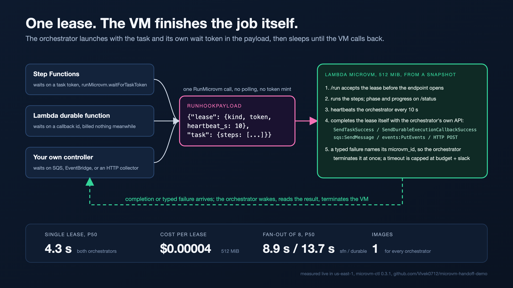

# AWS Builder Center format rules

The rules I follow when writing an article for AWS Builder Center, plus the script that turns a source article into a paste-ready bundle. Byline on every piece: Vivek Raja, AWS AI Hero.

## Form fields

| Field | Rule |
|---|---|
| Title | 255 characters max |
| Description | 512 characters max |
| Body | markdown |
| Cover image | 1200 x 675, jpg, png or webp, 2 MB max; text in the image is discouraged |
| Tags | up to 5 |
| Canonical URL | optional; leave empty when Builder Center is the first place the article appears |
| Series | pick the series name (create it once, with its own cover) |

## Source file layout

Each article is one markdown file. The front matter holds the form fields, and everything after the closing `---` is the body.

```markdown
---
title: "Article title, 255 characters max"
description: "One paragraph, 512 characters max."
series: "Building on AWS Lambda MicroVMs"
part: 4
tags: ["lambda", "step-functions", "serverless", "firecracker", "python"]
cover: "img/cover-03.png"
---

First paragraph of the body, on a single line.


```

## Body rules

1. One paragraph per line, with a blank line between paragraphs, so the body pastes without re-wrapping.
2. Plain ASCII punctuation only: straight quotes, no em-dashes, no unicode arrows (write `->` or `=>`).
3. Images are uploaded through the editor. Remote and relative image links do not render, so the paste bundle replaces each image with a marker (see the script below).
4. Diagrams ship as PNG. Mermaid is not assumed to render.
5. Cross-references to other parts are plain text ("part 2 of this series") until that part is live. Builder Center links resolve only between published articles; once a part is live, link its builder.aws.com URL.
6. Links to GitHub code are normal hyperlinks and work as is.
7. Write in first person ("I built", "my account"), never "we". The author context is AWS AI Hero.

## Style rules

From my writing rulebook, applied to every article:

- No negative parallelism ("not X, it's Y"), no countdown negations, no false ranges.
- No self-answering rhetorical questions, no false suspense ("here's the kicker").
- No filler transitions ("It's worth noting", "Importantly", "Notably").
- No staccato fragment paragraphs, no anaphora, no listicle in prose.
- No trailing "-ing" analysis tags ("highlighting its importance").
- No stakes inflation, no patronizing analogies ("think of it as"), no "the real story is" reveals.
- No vague attributions; name the source or drop the claim.
- Banned words: tapestry, landscape (as metaphor), paradigm, synergy, ecosystem (loose), framework (empty).
- No invented concept labels ("the X paradox").
- At most one rule-of-three per passage.

## Publishing checklist, per article

1. Run the bundle script after any edit to the article.
2. Copy the title and description from `publish/part-N-fields.md` into the form. The fields file prints the character counts, so check them against the limits.
3. Paste `publish/part-N-body.md` into the body.
4. At each `< FIGURE n of N: upload blog/img/<file> here >` marker, upload that file through the editor's image button, put the `Alt text:` line into the image's alt field, then delete both lines.
5. Upload the cover from `img/`.
6. Add the tags and pick the series.

## The bundle script

`blog/publish/make_bundle.py` reads each article, writes a fields file and a body file per part, and swaps every image for an upload marker.

```bash
python3 blog/publish/make_bundle.py
```

```python
"""Regenerate the paste-ready Builder Center bundle from the three series articles.

    python3 blog/publish/make_bundle.py

Bodies get a visible marker at every figure position instead of markdown image
syntax, because Builder Center only accepts uploads. The marker keeps spaces
inside the angle brackets so no markdown renderer treats it as a tag or autolink.
"""
import pathlib
import re

BLOG = pathlib.Path(__file__).resolve().parent.parent
PARTS = [(1, "00-control-and-scale.md"), (2, "01-seven-workloads.md"), (3, "02-multi-tenant-agents.md"),
         (4, "03-handoff.md")]

for n, f in PARTS:
    text = (BLOG / f).read_text()
    fm, body = text.split("\n---\n", 1)
    get = lambda k: re.search(rf'^{k}: (.*)$', fm, re.M).group(1).strip('"')
    imgs = re.findall(r'!\[[^\]]*\]\(img/([^)]+)\)', body)
    total, counter, placed = len(imgs), [0], []

    def marker(m: re.Match) -> str:
        counter[0] += 1
        heading = [h for h in re.findall(r'^#{2,3} (.*)$', body[:m.start()], re.M)] or ["(top)"]
        placed.append((counter[0], m.group(2), heading[-1]))
        return f"< FIGURE {counter[0]} of {total}: upload blog/img/{m.group(2)} here >\nAlt text: {m.group(1)}"

    body = re.sub(r'!\[([^\]]*)\]\(img/([^)]+)\)', marker, body)
    fields = (
        f"# Part {n}: form fields\n\n"
        f"Title ({len(get('title'))} chars):\n{get('title')}\n\n"
        f"Description ({len(get('description'))} chars):\n{get('description')}\n\n"
        f"Tags: {get('tags')}\nSeries: {get('series')}\nCover image: blog/{get('cover')}\n\n"
        "Figures, in body order. Each < FIGURE n of N > marker in the body is replaced by the upload; the\n"
        "Alt text line under it goes into the image's alt field; the italic line after it is the caption.\n"
        + "".join(f"  {i}. blog/img/{im}  (under \"{h}\")\n" for i, im, h in placed)
    )
    (BLOG / "publish" / f"part-{n}-fields.md").write_text(fields)
    (BLOG / "publish" / f"part-{n}-body.md").write_text(body.lstrip("\n"))
    print(f"part {n}: {len(imgs)} figure markers, {len(body.split())} words")
```

Example output in `publish/part-4-body.md`, where the source had a markdown image:

```text
< FIGURE 1 of 6: upload blog/img/hook-03-handoff.png here >
Alt text: One lease, the VM finishes the job itself: ...
```
